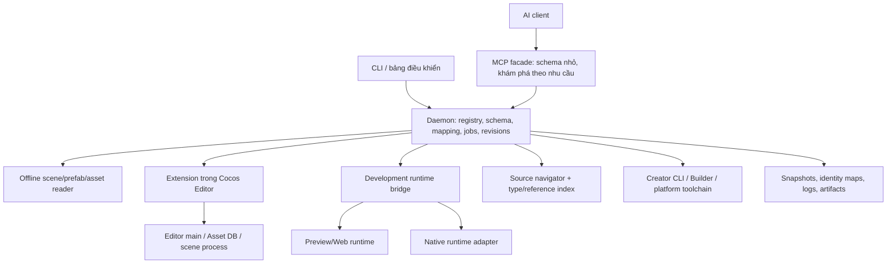

# Cocos AI Toolkit — thiết kế tổng thể v2

Ngày: 2026-10-23. Trạng thái: thiết kế để duyệt; bản lõi thử nghiệm đã có không có nghĩa là các khả năng trong tài liệu này đã triển khai.

## 1. Mục đích và yêu cầu đã xác nhận

Đây là bộ kit dùng chung cho Cocos, không dành riêng một game. Nó là cầu nối để AI giao tiếp với nhiều khía cạnh của engine bằng thao tác có cấu trúc, trả dữ liệu gọn và dễ kiểm tra.

Yêu cầu người dùng:

1. AI kết nối kit; kit kết nối Cocos.
2. Kit có thể chạy ngầm trên máy.
3. Ánh xạ mọi node UI, component và reference; AI đọc đường dẫn thay vì tự giải mã ID.
4. Chuyển đổi hai chiều: ID -> đường dẫn -> chỉnh value -> cấu trúc ID mà Cocos hiểu.
5. Không chỉ UI: mở rộng tới scene, asset, animation, render, physics, audio, runtime, build và debug.
6. Component gắn trong scene có thể dẫn về class/thư viện/source; AI đọc code, definition và references nhanh.
7. Hiện tại phải thiết kế kỹ, báo khi xong; chưa tiếp tục cài bridge hay sửa game.

Các lựa chọn stack, schema, giới hạn và thứ tự giao hàng bên dưới là đề xuất kỹ thuật. Chưa phải cam kết đã chạy hoặc bảo đảm mọi API ở mọi phiên bản Cocos.

## 2. Cách hiểu “mọi khía cạnh”, “tất cả UI/component”

Mục tiêu là **không giới hạn bằng một danh sách component hard-code**. Bất kỳ node/component engine biết đến đều được nhận diện hoặc bảo toàn danh tính/dữ liệu chưa hiểu; custom component không cần viết adapter mới chỉ để đọc property thông thường.

Bốn mức coverage riêng biệt:

| Mức | Ý nghĩa | Điều kiện được công bố |
| --- | --- | --- |
| Inventory | Liệt kê đối tượng/field/reference | Không bỏ sót âm thầm; phần chưa nhận dạng có trạng thái. |
| Read | Đọc đúng type/value/source/effective state | Có schema hoặc kết quả engine xác nhận. |
| Round-trip | Chuyển đi/chuyển về không mất dữ liệu | Fixture và engine deserialize/save/reload qua kiểm tra. |
| Write/execute | Sửa/call đúng ngữ nghĩa | Adapter typed + kiểm tra precondition + read-back phù hợp. |

Không dùng “đọc được class name” để tuyên bố class đó đã sửa được tất cả property hoặc thực thi được tất cả method. Unknown component vẫn có thể no-edit round-trip nguyên dữ liệu; mutation ở phần unknown chưa được kiểm chứng bị chặn.

Mọi kết quả coverage phải có: Creator/engine version, platform, source kind, số đối tượng/field đã thấy/đã ánh xạ/opaque/unresolved, khả năng write và lý do chưa hỗ trợ. Tỷ lệ chỉ tính trên inventory của project/phiên hiện tại, không lấy làm 100% toàn bộ engine.

## 3. Kiến trúc



Daemon chạy nhẹ khi idle. Adapter chỉ khởi động khi operation cần nó. CLI, MCP và UI dùng cùng dispatcher và schema, không có ba bộ logic khác nhau.

Phạm vi process bắt buộc: `offline`, `editor-main`, `editor-scene`, `preview-runtime`, `native-runtime`, `build-worker`. Mỗi operation ghi rõ process, thread/main-thread requirement và side effect. Dữ liệu Editor không đồng nhất với runtime, serialized property không đồng nhất với giá trị layout sau tính toán.

## 4. Capability registry — nền tảng để hỗ trợ rộng

### 4.1 Nguồn sinh inventory/schema

- API/type declarations, source engine và version metadata của Creator đã chọn.
- Registry class và metadata serialization từ engine đang mở trong Editor.
- Asset DB: UUID, db URL, importer, sub-asset, dependency, trạng thái import.
- AST/type checker của script project và package dependencies.
- Adapter thủ công cho operation có ngữ nghĩa đặc biệt, dữ liệu binary/native hoặc API không public.

Không dùng `Object.keys(component)` làm nguồn duy nhất. Trong engine 3.7.3 đã khảo sát, `__props__` có cả getter/property và `__values__` lọc thuộc tính serializable. Đây là chi tiết nội bộ phải đặt sau adapter phiên bản và probe; không hard-code làm API ổn định cho toàn bộ 3.x.

### 4.2 Mỗi capability khai báo

`name`, `area`, `inputSchema`, `outputSchema`, `process`, `supportedVersions`, `platforms`, `requiresEditor`, `requiresPlayMode`, `readOnly`, `approvalClass`, `idempotency`, `cancellation`, `resultBudget`, `verification`.

Các trạng thái: `available`, `requires-editor`, `requires-play-mode`, `requires-device`, `unavailable`, `experimental`. AI chỉ lấy schema chi tiết của operation cần dùng.

Không tự expose tất cả function trong source thành remote-call. Mã nguồn/type cho biết API tồn tại; không chứng minh nó gọi an toàn hoặc hợp lệ trong process hiện tại. Method call có side effect cần capability đã định nghĩa semantics, typed arguments, target scope và kiểm chứng.

## 5. Các miền engine và chức năng

| Miền | Đọc/tham chiếu | Thao tác thiết kế | Nơi thực thi |
| --- | --- | --- | --- |
| Project/Editor | Version, project, selection, scene, dirty/import/compile state | Mở/chọn scene, focus node, refresh theo phạm vi | Editor main/scene |
| Scene graph | Mọi root/node, activeSelf/activeInHierarchy, transform, layer | Tạo, rename, reparent, clone, xóa có precondition | Editor scene |
| Component | Built-in, kế thừa, project/package custom, field schemas | Add/remove/enable/property/binding theo schema | Editor scene |
| UI | Canvas, Widget, Layout, UITransform, Sprite, Label, RichText, Button, Toggle, Slider, ScrollView, Mask, EditBox, ProgressBar, Graphics và component khác | Bind event/reference, sửa constraint, đo geometry và read-back | Editor + runtime |
| Prefab | Asset, instance, nested instance, source/effective value, override origin | Chọn đúng scope instance/base; apply/revert chỉ khi explicit | Editor prefab workflow |
| Asset/resource | UUID, URL/path, importer, sub-assets, dependency graph | Import/create/move/rename/rebind qua Asset DB | Editor main |
| Animation | Clip/controller/state/track/event, Spine/SkeletalAnimation khi có | Preview/play/stop/scrub/binding theo adapter | Editor/runtime |
| Render/material | Camera, renderer, light, pipeline, shader/effect, material/texture properties | Thay resource/property với schema; preview và ảnh so sánh | Editor/runtime/build |
| Physics | 2D/3D collider, rigid body, joint, collision matrix | Sửa config; debug state/query khi runtime hỗ trợ | Editor/runtime |
| Audio | AudioClip, AudioSource, channel/voice state khi backend cung cấp | Play/stop/volume trong development; phân tích file tùy adapter | Runtime/offline |
| Input/events | ClickEvent, handler, binding, input actions đã đăng ký | Bind đúng signature; input simulation trong development | Editor/runtime |
| Runtime/lifecycle | Scene/node/component đang sống, flags, errors, timescale | Pause/step/wait/targeted state queries có hỗ trợ | Runtime bridge |
| Memory/pool/resources | Inventory asset/node, lifecycle và pool telemetry khi có | Snapshot/compare; không coi số JS là toàn bộ native memory | Runtime/native adapter |
| Profiler/debug | Console, stack trace, counters, screenshots, selected traces | Capture có giới hạn, filter/deduplicate, sourcemap | Editor/runtime/native tools |
| Build/deploy | Profile, SDK/toolchain, dependency, artifact, log | Validate/export/compile/package; install/launch đúng device | Build worker |
| Source/library | Definition, inheritance, imports, symbol/reference, serialized bindings | Đọc đoạn code; source edit là proposal riêng | Offline/type index |
| Extension/plugin | Packages/versions, contributed APIs và schemas | Nạp capability provider, compatibility probe | Editor/daemon |

Đây là ma trận kiến trúc và backlog, không phải danh sách chức năng đã ship. Audio/Spine/third-party packages không tự có telemetry sâu chỉ vì chúng xuất hiện trên component.

## 6. Mô hình dữ liệu: graph có type

Không coi scene là cây JSON thuần. Graph gồm:

- Project -> scene/prefab asset -> prefab instances -> nodes.
- Nodes -> component instances -> registered class/schema/source.
- Serialized records, value types, shared records và references có chu trình.
- Assets -> sub-assets/importers -> material/font/audio/texture/clip/effect dependencies.
- Event bindings -> target node/component -> method -> custom data.
- Runtime objects -> editor/source counterpart nếu có bằng chứng, hoặc runtime-only.

Mỗi entity có identity nội bộ scoped theo project + source + document/session. Tham chiếu graph luôn explicit; không inline đệ quy vô hạn hay clone shared object khi chuyển format.

### 6.1 Tách ba loại tên

1. `identity`: UUID/fileId/object slot/live instance identity; không xuất mặc định cho AI.
2. `handle`: token ngắn của snapshot/session để thao tác chính xác; hết hạn khi revision/session đổi.
3. `path`: nhãn con người/AI đọc, dùng cho navigation và chọn đối tượng khi duy nhất.

Đường dẫn có namespace của scene/prefab và loại đối tượng. Ví dụ:

```text
scene://Main/Canvas/Settings/CloseButton
prefab://db/assets/ui/Settings.prefab/Settings/CloseButton
component://Main/Canvas/Settings/CloseButton#cc.Button[0]
asset://db/assets/ui/buttons.png#sprite-frame/close
source://project/assets/scripts/Settings.ts#Settings/onClose
```

Các chuỗi URI trên là dạng hiển thị. Machine contract dùng tuple, không parse URI hiển thị theo phỏng đoán:

```ts
interface EntityRef {
  project: string;
  source: 'disk' | 'editor' | 'runtime';
  document: string; // db://assets/... hoặc runtime document do adapter cấp
  session: string | null;
  revision: string;
  handle: string; // snapshot-scoped; không phải ID serialized của Cocos
  path: string; // slash/tilde/bracket/hash đã escape
  component?: { type: string; ordinal: number };
}
interface AssetRef {
  project: string;
  document: string; // URL chính xác do Asset DB/index trả
  subAsset: string | null; // sub-asset key có type/importer, không tự suy từ tên ảnh
  expectedType: string | null;
}
```

Một property reference là union tagged `node | component | asset | record | null | unresolved`, không phải string tự do. AI có thể nhập path ngắn trong query; kit phải resolve ra tuple đầy đủ và từ chối ambiguous/stale trước write. Asset DB/index quyết định sub-asset key, không đoán theo tên hiển thị.

Tên node có slash/tilde/bracket/hash phải escape. Duplicate sibling dùng disambiguator theo snapshot; đây không phải identity bền vững. Rename/reparent/reorder bắt buộc xử lý bằng handle + revision, không tự resolve path cũ sang node khác.

### 6.2 Dữ liệu UI cho AI

```yaml
source: editor
revision: scene-revision
node: scene://Main/Canvas/Settings/CloseButton
activeSelf: true
activeInHierarchy: true
components:
  - type: cc.Button
    ref: handle-from-current-snapshot
    properties:
      interactable: true
      clickEvents:
        - target: scene://Main/Canvas/Settings
          component: Settings
          handler: onClose
          customEventData: ''
  - type: cc.Sprite
    properties:
      spriteFrame: asset://db/assets/ui/buttons.png#sprite-frame/close
```

Field aliases công khai như `Widget.top` chỉ được ánh xạ sang serialized backing field `_top` khi adapter/schema xác nhận. Không bỏ `_` trên mọi tên field theo quy tắc đoán.

### 6.3 Protocol graph/patch v1 tối thiểu

```ts
type Value =
  | { kind: 'null' }
  | { kind: 'boolean' | 'string' | 'number'; value: boolean | string | number }
  | { kind: 'enum' | 'bitmask'; type: string; value: number; label?: string }
  | { kind: 'value'; type: string; fields: Record<string, Value> }
  | { kind: 'array'; elementType: string; items: Value[] }
  | { kind: 'ref'; targetType: 'node' | 'component' | 'record'; target: EntityRef }
  | { kind: 'asset-ref'; target: AssetRef }
  | { kind: 'opaque'; payloadHandle: string; typeHint: string; reason: string }
  | { kind: 'unresolved'; rawHandle: string; expectedType: string; reason: string };
type PropertySelector = Array<{ field: string } | { index: number }>;
interface PatchStep {
  operation: string; // closed enum trong capability schema; không phải free-form eval
  target: EntityRef;
  selector?: PropertySelector;
  expected?: Value;
  value?: Value;
  arguments?: Record<string, Value>;
}
```

Atom kind và value phải khớp chính xác ở validator; number đặc biệt không thể JSON encode thành số thường thì dùng opaque codec đã có type. Shared/cyclic object luôn là record ref, không lặp Value.fields vô hạn. Non-reference user data vẫn là atom/value/array, không được đổi thành ref bằng heuristics.

Selector là segment array, không split tên property theo dấu chấm hay slash. Array `set/insert/remove/move` là capabilities riêng, mọi index gắn với base revision; khi revision đổi phải rebase bằng item identity nếu chứng minh được, nếu không thì từ chối. Các operation chưa qua adapter qualification không được advertise writable.

Path segment dùng JSON Pointer escaping `~0` cho `~`, `~1` cho `/`, cộng `~2` cho `[`, `~3` cho `]`, `~4` cho `#`; duplicate siblings thêm `[ordinal]` ngoài escaped name. Root document nằm trong EntityRef.document, không suy document từ node path. Nhãn URI hiển thị không phải wire grammar.

Graph format có `formatVersion: 1`, entity table và roots; typed values chỉ trỏ table/AssetRef. Opaque handle được bind với snapshot/payload hash; AI không được tự sửa payload hidden. PatchStep operation enum ban đầu gồm `property.set`, `reference.bind`; các nhóm `node.*`, `component.*`, `array.*`, `asset.*`, `source.*`, `build.*`, `deploy.*`, `method.call` chỉ xuất schema khi backend tương ứng được chứng nhận.

## 7. Registry và reflection cho mọi component

Pipeline:

1. Discover class type/UUID/script, base classes và registered name.
2. Thu metadata đã kế thừa; phân biệt field serialize, editor-only, hidden, getter/setter, runtime-only.
3. Xác định value type, enum/bitmask, range, nullable, array/list element type, asset/component subtype.
4. Đối chiếu Inspector dump/engine metadata với AST khi đọc được source; mâu thuẫn phải hiện ra, không tự chọn bên tiện nhất.
5. Tạo schema read/write và field-to-serialized mapping.
6. Đặt adapter đặc biệt trên generic layer cho class cần lifecycle/layout/native actions.

Yêu cầu xử lý:

- Custom `@ccclass`, decorator aliases, inheritance, exported/re-exported classes, enum và generics có thể resolve.
- `serializable:false`, readonly getter, dynamic fields không được coi là persistent writable field.
- `formerlySerializedAs` và class/schema migration được versioned; không tự đổi field theo tên mới mà làm mất dữ liệu cũ.
- Null có declared type vẫn có thể bind khi live schema xác nhận; không suy kiểu từ giá trị null.
- Arrays có thứ tự, item identity, shared data, cycles và record subtype không bị flatten sai.
- Missing script/type: giữ nguyên raw payload, báo missing, source navigation unavailable; vẫn no-edit round-trip được nếu dùng writer opaque-preserving.
- Component mới được discover sau compile/import; invalidation schema cũ và proposals liên quan.
- Schema introspection không gọi mọi getter tùy ý. Getter read có side effect hoặc không an toàn được yêu cầu adapter rõ.
- Một code adapter Cocos 3.7.3 không tự nhận tương thích 3.8/2.x.

## 8. Chuyển đổi hai chiều và khả năng Cocos hiểu

### 8.1 Pipeline

```text
Cocos serialized graph (hoặc Editor snapshot)
 -> decode + identity/dependency table
 -> normalized typed graph
 -> path-based view cho AI
 -> typed patch/proposal
 -> validate against base revision/schema/target scope
 -> apply bằng Editor APIs hoặc offline writer đã được chứng nhận
 -> Cocos save/import/deserialize/reload
 -> read-back + verify
```

AI không phải sửa các file map. Bảng ánh xạ được kit quản lý và gắn với revision; view có thể export để đọc/chỉnh value, nhưng import phải qua validator.

### 8.2 Chỉ thay reference IDs, không đổi dữ liệu nghiệp vụ

Định dạng và schema xác định đâu là identity/reference: object slot `__id__`, asset reference `__uuid__`, class ID và prefab-local IDs. Một field gameplay tên `id`, chuỗi UUID do người dùng lưu, enum number, event custom data hay database key không tự biến thành path. Không regex-replace mọi UUID/number/string trong file.

View AI có thể giấu metadata storage; opaque payload giữ trong identity map/artifact nội bộ. Khi người dùng yêu cầu full/raw thì trả theo phạm vi và budget, không đưa payload lớn vào mọi lượt đọc. Chỉ hiển thị unresolved marker không có nghĩa được phép xóa dữ liệu gốc.

### 8.3 Các mức round-trip

- **No edit:** byte-identical cho file gốc; opaque chunks được giữ nguyên. Không cần hiểu mọi record để bảo toàn chúng.
- **Property/ref edit:** giữ nguyên IDs/fileIds và phần không đổi; chỉ sửa value/reference đúng schema.
- **Structural edit:** thêm/xóa/clone/reparent component/node phải cấp và remap identity theo engine/version; nested prefab mặc định dùng Editor serializer, không tự dựng JSON theo array index.
- **Cross-file edit:** theo dependency graph và mutation plan có affected assets rõ; không áp dụng từng file rồi báo atomic nếu thực tế không atomic.

Cocos không trực tiếp hiểu format path-based; kit chuyển ngược thành native serialization trước khi Cocos sử dụng. “Cocos vẫn hiểu” chỉ được xác nhận sau khi Editor nhận lại dữ liệu đúng, không phải chỉ `JSON.parse` thành công.

### 8.4 Chế độ làm việc

- Editor mở/dirty scene: thao tác qua Editor, giữ unsaved changes; không overwrite disk từ snapshot cũ.
- Editor đóng: offline writer chỉ cho schema/format đã qua round-trip qualification; ưu tiên xuất file riêng/dry-run, không tự ghi vào source.
- Editor/runtime view: path có thể cùng nhãn nhưng khác namespace và identity. Không gán ID runtime vào file asset.
- Build artifacts có serialization format khác asset source: không dùng cùng parser nếu chưa có adapter.

## 9. Prefab, override và effective values

Mỗi field có provenance: `baseAsset`, `nestedInstance`, `localOverride`, `runtimeValue`.

Inspect mặc định có thể trả effective value kèm origin. Proposal bắt buộc chỉ rõ `instance` hay `prefab-asset`; thay đổi một nút của một instance không được âm thầm sửa toàn bộ instances.

Giữ riêng prefab root identity, local target IDs, source asset IDs, mounted/removed components, child-instance relationships và property override paths. Các metadata này không được xóa vì AI không muốn thấy ID.

Rename/reparent/delete bị engine cấm trong một prefab context phải trả unsupported/precondition; không unpack prefab để lách hạn chế. Apply/revert/unpack là operation riêng với tác động rõ.

Nested-prefab target descriptor bắt buộc gồm `document`, `stage`, `instanceChain`, `owningAsset`, `overrideOwner` và `scope`. `instanceChain` là chuỗi identity của từng prefab instance từ document root tới target; `scope` là `scene-instance`, `containing-prefab-instance` hoặc `source-prefab-asset`. Mỗi field provenance là danh sách các tầng base/override đã áp, không phải một nhãn origin duy nhất.

Ví dụ cùng nút Close trong nested prefab: sửa override trên scene instance, sửa nested instance trong asset Popup chứa nó, và sửa asset Button nguồn là ba proposal khác nhau. Preview phải liệt kê đúng asset sẽ ghi và những lớp instance chịu ảnh hưởng; không suy scope từ việc node đang được chọn.

Cross-prefab/shared asset refs và dependency cycles phải traversal có visited set, depth/size budget và dependency report. Không coi prefab thiếu source là fully resolved.

## 10. Source Navigator — ref trực tiếp vào thư viện component

### 10.1 Nguồn hỗ trợ

- Script trong project.
- Package/submodule/npm dependency được project đăng ký và engine/Editor dùng.
- Source Cocos đúng bản cài hoặc custom-engine path đã chọn.
- `.d.ts`, source maps và source TS/JS tương ứng.
- C++/Objective-C/Java/platform layer như adapter riêng khi source/toolchain có sẵn.

Không thấy source thì trả declaration/type/documentation hoặc compiled location có nhãn rõ. Không biến `.d.ts` thành implementation; không hứa khôi phục source gốc từ binary.

### 10.2 Chuỗi navigation

```text
node path
 -> component instance
 -> class identity + registered name
 -> project/package/engine source
 -> declaration + implementation
 -> inheritance/import/re-export graph
 -> symbol definitions/references/call candidates
 -> serialized bindings và UI event targets
```

Các query: `component.source`, `symbol.definition`, `symbol.references`, `symbol.implementation`, `type.hierarchy`, `method.body`, `property.schema`, `event.bindings`, `source.dependencies`, `diagnostics`.

Mỗi đoạn code có URI/path, range dòng, symbol, source hash và version. AI lấy một method hoặc một range nhỏ, không tải cả thư viện. Large result có cursor/artifact; source không có trong workspace hiện tại không được đoán đường dẫn.

Static reference và runtime observation là hai loại bằng chứng. Dynamic event names, reflection, closures, JS mutation và native bridging khiến call graph có thể thiếu; phải hiện `confidence` và `unresolvedDynamicEdges`.

Source edit/refactor là mutation riêng: AST/text proposal, compiler/type check, serialized-field migration khi cần và read-back. Đọc thư viện không đồng nghĩa được tự sửa engine/vendor code. Kit vẫn có thể tạo proposal ở source được ủy quyền, không tự biến thao tác đọc thành sửa.

## 11. Giao tiếp AI và tiết kiệm context

Sáu tool nhỏ đề xuất: `describe`, `query`, `propose`, `apply`, `job`, `artifact` (namespace cocos).

- `describe`: areas, versions, connection state và schema đúng operation cần dùng.
- `query`: đọc source/scene/component/engine state; batch các truy vấn độc lập.
- `propose`: kế hoạch tác động và semantic before/after diff, chưa ghi.
- `apply`: proposal hợp lệ đã được user/task authorization cho phép, theo policy cấu hình.
- `job`: tác vụ dài, start/status/cancel, build/debug capture.
- `artifact`: lấy log/source chunk/screenshot/snapshot report theo giới hạn.

Schema chung có `project`, `session`, `source`, `operation`, `params`, `requestId`; response có `status`, `revision`, `summary`, `warnings`, `coverage`, `evidence`, `resultRef`, `nextCursor`.

Mặc định tree depth 2, 50 node; text budget 6.000 ký tự là giới hạn trình bày, không đồng nghĩa 6.000 token. Không trả cùng một payload đầy đủ hai lần qua text và structured output. Schema/query dùng field selection, filter và grouping; không âm thầm loại findings.

AI yêu cầu `ifRevision` nhận `unchanged` khi đúng. Cache theo source/engine/schema revision, không theo tên file đơn thuần. Filesystem watcher chỉ invalidation hint; freshness để ghi phải kiểm tra nội dung/dependencies và Editor revision.

### 11.1 Revision, snapshot và pagination

- `documentRevision`: hash/opaque monotonic token do process sở hữu document cấp; bao gồm serialized/effective state của document và các dependency revisions đã resolve. Không dùng một project revision chung thay cho mọi document.
- `schemaRevision`, `assetIndexRevision`, `sourceIndexRevision`, `engineFingerprint` là các token riêng. Snapshot ghi revision vector các thành phần nó thực sự dùng; proposal pin đúng vector đó.
- Snapshot là immutable. Cursor gắn snapshotId + query/filter hash + offset, có signature nội bộ; phân trang không đọc tiếp từ scene mới. Snapshot đầu trả capture time và nguồn.
- Snapshot TTL mặc định 5 phút sau lần truy xuất cuối; LRU tối đa 10 snapshot hoặc 128 MiB payload. Vượt budget có thể page-to-disk theo user cache; không âm thầm thay snapshot bằng bản mới. Đã evict thì trả `SNAPSHOT_EXPIRED` cùng hướng dẫn query lại.
- Handle hết hạn trả `STALE_HANDLE`, không tự tìm node cùng path để tiếp tục write. Cursor sai query/source/revision trả `CURSOR_MISMATCH`.
- Runtime snapshot ghi frame/time window. Adapter lấy được cùng một frame mới ghi `consistentFrame=true`; nếu capture kéo dài qua frames thì ghi khoảng quan sát và `consistentFrame=false`, không trình bày như state atomic. Không tự pause gameplay chỉ để đọc.
- Code range trả source hash, schema/symbol queries trả sourceIndexRevision; file thay đổi phải invalidate/re-resolve range, không giữ line number cũ làm bằng chứng mới.

Không lưu cả raw scene trong mỗi lượt chat. Kit giữ snapshot/identity map/artifact ngoài context, AI chỉ giữ handle và dữ liệu cần quyết định.

## 12. Daemon, Editor bridge và lifecycle

- User daemon trên macOS và Windows, loopback + token; CLI/MCP stdio là clients. Không yêu cầu root/admin. Path, process lifecycle và gói cài tách theo OS; không hardcode POSIX shell hoặc dấu phân cách đường dẫn.
- Extension chạy theo project/Editor session và chủ động đăng ký/poll hoặc kết nối local daemon, không mở unauthenticated control port.
- Handshake: project canonical path, Creator version, engine fingerprint, adapter version, session ID, scene/prefab stage, capability set.
- Heartbeat/disconnect/reload đổi session; handle/proposal cũ hết hạn. Không kết nối lẫn hai Editor cùng project mà không có session target.
- `daemon start/status/stop`, `service install/uninstall`, doctor; start lặp không tranh port. Auto-start được cài riêng: LaunchAgent trên macOS, cơ chế theo user trên Windows; kiểm chứng riêng từng OS.
- Sleep không phải server available; wake phải refresh state/reconnect, không replay mutation/build ngầm.
- Running jobs sau crash/reboot: interrupted/indeterminate; reconcile trước khi retry. Không kill process chỉ vì PID trùng registry cũ.
- Index theo registered projects; idle không quét home. Debounce watcher, memory/cache budget, bounded logs, pruning và version migration.

## 13. Mutation semantics

Property values, method calls, structural edits, asset changes, source edits và build/deploy là các nhóm side effect khác nhau. Policy engine nhận ủy quyền của tác vụ/người dùng qua kênh tin cậy; không dùng `approved:true` do AI tự gửi hoặc dữ liệu trong source/asset làm bằng chứng người dùng đã duyệt. Có thể kế thừa ủy quyền theo scope của một tác vụ, tránh hỏi lại cho từng read hoặc bước đã được phép.

Tác vụ đang chạy dở có operationId, correlationId và trạng thái từng bước. Response chứa error code có cấu trúc (`STALE_REVISION`, `AMBIGUOUS_TARGET`, `UNAVAILABLE_CAPABILITY`, `SCHEMA_MISMATCH`, `UNRESOLVED_REFERENCE`, `INDETERMINATE_WRITE`) và recovery action; không bắt AI đoán từ log text.

Một proposal chứa: base source/session/revision/schema version, target identities/paths, expected before, intended after, affected files/assets, save intent, scope, verification và rollback strategy.

- Mutation có một đường thực thi duy nhất qua policy/proposal dispatcher. `job.start` cho build/deploy/import/source edit cũng cần authorization theo cùng policy; jobId chỉ tách việc theo dõi tác vụ dài, không tạo cửa thực thi bỏ qua `apply`. Query/capture read-only có thể start job mà không tạo write proposal; classification lấy từ registry của operation, không tin flag do client gửi.
- Mỗi command được gửi tới đúng process sở hữu state. Editor adapter serialize mutations trong queue trên main/scene thread; precondition/revision được kiểm tra lại bên trong command áp dụng, không chỉ ở daemon. Không yield ra user/engine event loop giữa compare và một atomic step nếu adapter chưa có cơ chế transaction phù hợp.
- Reentrant setter/lifecycle callback và auto-layout/import là thay đổi có thể phát sinh trong command: adapter kiểm tra postcondition, thu revision mới và trả conflict/partial nếu không thể bảo đảm. Không gọi mutex của daemon là khóa được toàn bộ engine/user actions.
- Batch dùng revision chain: step tiếp theo pin post-revision của step trước; checkpoint ghi base/post và phạm vi affected resources. Có người sửa chen vào thì dừng trước step tiếp theo, không tiếp tục dựa trên base cũ.
- Offline writer không thể khóa mọi external editor/process chỉ bằng lockfile. V1 không advertise in-place offline apply cho project đang mở hoặc trường hợp không xác nhận exclusive write ownership; dùng separate output/dry-run. Những adapter được mở in-place sau này phải nêu chính xác concurrency guarantees và kiểm tra import/reload, không hứa compare-and-rename là CAS filesystem với external writers.
- Preflight ngay trước apply: target còn đúng, field type/range/nullability đúng, requiredComponent/dependencies, engine restrictions, revision và ownership không đổi.
- Cocos setter/Editor command được ưu tiên cho field có lifecycle; không gán backing field để né constraint.
- Idempotency key tránh duplicate request. Timeout sau write trả indeterminate cho tới read-back; không auto retry create/delete.
- Undo dùng Editor support khi xác minh được. Multi-asset batch không atomic phải per-step state và checkpoint; rollback không ghi đè thay đổi mới của người dùng.
- Save/compile/import/layout được chờ tới điều kiện có thể quan sát; không dùng delay cố định làm bằng chứng thành công.
- Read-back chỉ chứng minh property/state đã đổi. Visual/gameplay/native correctness cần kiểm tra riêng.

## 14. Build, diagnostics và execution

Profile versioned: Creator/custom engine, target, scene/bundles, toolchain/config, debug/release, output và device target nếu cần install/launch.

Task graph: doctor -> input validation -> export -> compile -> package -> artifact. Device install/launch và runtime capture là task riêng. Mỗi stage có input/output fingerprint, locks và cancellation ownership.

Tận dụng Builder hiện có qua adapter có protocol/version rõ; không phụ thuộc một đường dẫn máy cá nhân hard-code trong kit phát hành.

Cache không dùng lại khi engine/config/dependency/source đổi hoặc đổi giữa build. Artifact manifest ghi source revision và stale status. Build pass khác launch pass, visual pass, gameplay pass và native-device pass.

Diagnostics có cùng graph: error stack -> source range -> class/method -> component instances -> related assets/UI. Cảnh báo từ một lần parse không tự chứng minh crash hoặc runtime bug.

## 15. Stack và module boundaries

### 15.1 Hướng ngôn ngữ đã thống nhất

**Kết hợp JavaScript/TypeScript và Python.** Người dùng cho phép bổ sung C++ hoặc Go nếu cần thiết. TypeScript là lựa chọn đề xuất để phát triển phần JavaScript có type/schema rõ ràng; output extension vẫn là JavaScript phù hợp Cocos Editor. Không bắt buộc dùng cả bốn ngôn ngữ ngay ở bản đầu.

| Phần | Ngôn ngữ | Vai trò và ranh giới |
| --- | --- | --- |
| Daemon, CLI, MCP, graph codec, source index | JS/TypeScript trên Node.js | Core điều phối và schema contracts; hợp dữ liệu JS/TS của Cocos và source navigation. |
| Extension Cocos Editor | TypeScript build ra JavaScript theo phiên bản Editor | Chia sẻ contract nhưng chạy JS phù hợp runtime Editor; không phụ thuộc Node API của daemon. |
| Runtime development bridge | TypeScript theo build target project | Làm việc với node/component và type của Cocos; adapter Web/native tách riêng. |
| Build, asset/audio processing và tác vụ script | Python worker/adapter | Tận dụng thư viện/backend phù hợp; giao tiếp với core bằng protocol có version, không import Python vào scene process. |
| Native bridge hoặc thuật toán nặng đã đo được | C++ khi cần | Bám API/ABI engine theo phiên bản; tách khỏi Editor JS, có tests và crash boundary rõ. |
| Worker/dịch vụ độc lập cần executable riêng | Go khi cần | Dùng protocol chung để core gọi; không tạo daemon thứ hai trùng trách nhiệm nếu không có lý do. |

Core JS là nơi sở hữu request/proposal/job lifecycle. Worker Python/Go/C++ chỉ xử lý tác vụ được giao; không tự resolve target khác hoặc ghi project ngoài mutation plan. Hợp đồng xuyên ngôn ngữ dùng JSON Schema có version; control messages đi qua JSON Lines/stdin-stdout hoặc loopback RPC xác thực; dữ liệu lớn dùng artifact handle thay vì nhét byte/base64 vào mỗi request. Log đi stderr/log artifact, không trộn với protocol stdout. Timeout/cancel/error/status thống nhất, không coi process exit 0 là mọi stage đã được kiểm chứng.

Các công đoạn giao tiếp nặng được phép chuyển sang Go hoặc C++ theo yêu cầu người dùng: vận chuyển nhiều snapshot/artifact, xử lý hàng đợi và codec binary khi có benchmark chứng minh bottleneck. Go phù hợp worker I/O đồng thời đóng gói executable; C++ phù hợp native engine bridge hoặc codec cần kiểm soát bộ nhớ. Đây là lựa chọn triển khai sau đo đạc, không phải cam kết tự động nhanh/nhẹ hơn TypeScript.

Trước khi thay worker phải đo p50/p95 latency, throughput, CPU/RSS và chi phí copy/serialization trên cùng workload ở cả macOS/Windows. Giữ nguyên versioned contract, backpressure/hàng đợi có giới hạn, timeout/cancel, kiểm tra kích thước và lỗi có cấu trúc. Worker crash không được làm daemon mất state; chỉ retry thao tác read/idempotent. Binary artifact có checksum/length và handle theo project/session; chưa cần binary protocol mới trong P1. Không đưa C++ addon vào cùng process chỉ để tối ưu khi có thể dùng worker riêng.

Lợi ích tiết kiệm token chủ yếu đến từ typed graph, query gọn, schema discovery, cache và batching; không tự có chỉ vì chọn một ngôn ngữ. Code vẫn cần phân biệt compile-time types với runtime validation của request/property.

### 15.2 Ranh giới module và runtime

- Core/CLI/MCP/indexer: TypeScript, Node.js version đã pin; hỗ trợ 22.16+ nếu các dependencies thực tế tương thích.
- Cài/chạy core trên macOS và Windows là yêu cầu chung. CI chạy cả hai OS; test path giả lập không thay cho chạy thật trên Windows. Worker native phải có artifact theo OS/architecture, capability báo thiếu/incompatible rõ ràng.
- Editor extension: JS build target phù hợp Cocos 3.7.3; không import Node API hiện đại vào scene runtime nếu môi trường không hỗ trợ.
- Schema generator, engine-version adapter, class registry, graph codec, path resolver, source navigator, query formatter, mutation engine, job runner là module riêng.
- Runtime bridge opt-in/development; Web và native có transport/capability riêng, release không tự chèn bridge.
- Python workers là thành phần theo capability; phần đọc/query core vẫn hoạt động nếu tác vụ đó không cần Python/SDK. Chỉ doctor yêu cầu worker cho capability thực sự được gọi.
- Repo/tool data tách project game. CLI không lấy 9689/9723 làm default hay bundle game source/assets vào gói cài.

## 16. Kiểm chứng và coverage matrix

Đầu tiên nghiệm thu Creator 3.7.3; các bản khác chỉ advertise sau compatibility tests.

| Nhóm kiểm chứng | Cases bắt buộc |
| --- | --- |
| Identity/path | Trùng tên, ký tự đặc biệt, rename/reparent/reorder, stale handles, shared refs, cycles, dangling refs, foreign project/session |
| Class/schema | Built-in, custom, inherited, package, missing script, enum/bitmask, arrays, null typed refs, hidden/editor-only, read-only, renamed fields |
| UI/layout | Inactive hierarchy, anchor, transform/scale, Widget target, Layout, ScrollView content/view, masks, rich text/font/sprite sub-assets, deferred layout |
| Prefab | Base, instance, nested, overridden property/ref, mounted/removed component, source missing, duplicate instance names, unsupported engine operation |
| Assets | UUID compressed/plain, importer sub-assets, atlas frames, renamed/moved assets, material texture refs, animation/audio/font/skeleton dependencies |
| Two-way | No-edit byte equality; changed field only; IDs retained; source unchanged where unrelated; deserialize/save/reload and equivalent effective values |
| Source | Component->source exact version, definitions/reexports/inheritance, imports, declaration-only, generated/minified/source maps, dynamic unknown refs |
| Concurrency | Dirty scene, compile/import, file changed, engine change, two sessions, timeout/disconnect during apply, partial batch/rollback conflict |
| Runtime/build | Preview/native separation, source vs runtime-only objects, cancellation, interrupted jobs, stale output/cache, explicit device target |
| Context/performance | Fixed tasks/tokenizer, no missing warnings after compaction, pagination completeness, cold/warm reads, CPU/memory at idle |

Coverage discovery phải chạy trên actual component registry của project, không chỉ số fixture do kit tự chọn. Báo `inventory/read/roundtrip/write` riêng cho mỗi type và field class. Generic fields có shared qualification tests; special components có integration tests.

Các benchmark tiết kiệm token/tốc độ là mục tiêu cần đo. Không kế thừa phần trăm tiết kiệm từ Unity MCP Efficient thành lời hứa cho Cocos.

## 17. Roadmap theo phụ thuộc

1. **Protocol/capability + identity/schema foundation:** chốt grammar, source namespaces, lifecycle và version adapter đầu tiên.
2. **Generic graph mapping + reversible UI view:** read/export/query; không bỏ refs/metadata; offline/compiler và engine read-back qualification.
3. **Editor connection + generic component schemas:** mọi registered type được inventory; live scene/prefab, effective values và coverage report.
4. **Source Navigator:** engine/project/package source và symbol/reference queries tích hợp component graph.
5. **Mutation framework:** property/binding trước; sau đó structural/prefab/asset/source operations có adapter và tests.
6. **Runtime domains:** animation/render/physics/audio/input; mở capability theo transport/platform thật sự hỗ trợ.
7. **Build/debug/profiler adapters:** jobs, cache, logs, artifacts, platform integration.
8. **Packaging/daemon/service + benchmark + qualification:** installer/update/recovery và tài liệu compatibility. Daemon manual có thể chạy từ mốc sớm; auto-start/package chỉ phát hành khi đã nghiệm thu.

Không nhận một alpha reader là đã hoàn thiện engine toolkit. Mỗi mốc giao capability manifest và phần chưa có, không đổi mục tiêu “generic kit” thành script riêng cho game.

## 18. Trạng thái hiện tại và bước sau duyệt

Prototype tại `/Users/fe-ducphu/cocos-ai-toolkit` đã có TypeScript graph reader cơ bản, path-based view, property/ref round-trip, query và loopback daemon thử nghiệm. 11 automated tests đã qua trong lần chạy trước. Đây không phải qualification cho mọi component, nested prefab, Editor/runtime hay build.

Một lượt rà soát độc lập đã kiểm tra bản thiết kế về revision/snapshot consistency, race khi mutation, scope nested prefab, graph/patch wire contract và policy của job; các quyết định đã bổ sung trong mục 6.3, 9, 11.1 và 13.

Đã thử read-only với một prefab thực: 160 node, no-edit round-trip byte-identical; có unresolved/override warnings nên không cho mutation. Không sửa game, chưa cài extension, chưa cài LaunchAgent, chưa chứng minh Cocos reload bản đã chỉnh.

Sau khi người dùng duyệt thiết kế v2 mới cập nhật implementation plan theo roadmap này, rồi tiếp tục code. Giữ prototype như bằng chứng/fixture tham khảo, không coi các quyết định tạm của nó là schema cuối.

### 18.1 Kế hoạch phase và test đã lập

Kế hoạch triển khai tiếp theo: [8 phase / 17 task](plans/2026-10-23-implementation-v2.md). Bộ test: [212 case nền tảng](testing/test-cases.md), [CSV](testing/test-cases.csv), [JSON](testing/test-cases.json). Catalog đang NOT_RUN; số case không đồng nghĩa toàn engine đã được chứng nhận. Các component/field classes được parametrized theo registry thực.

## 19. Nguồn tham khảo và giới hạn xác minh

- [Cocos 3.7 Decorator](https://docs.cocos.com/creator/3.7/manual/en/scripting/decorator.html): serialized properties, hidden/editor attributes và inheritance.
- [Cocos 3.7 Prefab](https://docs.cocos.com/creator/3.7/manual/en/asset/prefab.html): nested prefab, overrides và giới hạn chỉnh hierarchy.
- Source engine 3.7.3 trên máy: `cocos/core/data/class.ts`, `cocos/serialization/deserialize.ts`, `cocos/scene-graph/prefab/prefab-info.ts`; chi tiết nội bộ phải được adapter/version probe.
- [Cocos scene script documentation, phiên bản 3.3](https://docs.cocos.com/creator/3.3/manual/en/editor/extension/scene-script.html): mô hình scene script/execute-scene-script; không lấy tài liệu 3.3 làm bằng chứng mọi API 3.7 giống hệt.
- Extension local hiện có dùng Editor.Message scene/asset-db là mẫu tích hợp được khảo sát, chưa phải bridge của kit đã được kiểm thử.
- [MCP for Unity](https://github.com/CoplayDev/unity-mcp), [Unity MCP Efficient](https://github.com/Vangardo/unity-mcp-efficient): typed Editor bridge, resource navigation, discovery, batching và context compaction.
- [SuperUnityBuild](https://github.com/superunitybuild/buildtool): build profiles và extensible task actions.
